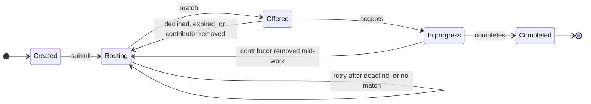

# Task Routing — Requirements & Open Decisions

Oct 21, 2026 · @Tanu

> Exported from the living doc on 2026-10-22: https://claude.ai/artifact/GM1LGyDXinfQVgt7ccb3Pp. The lifecycle diagram is reproduced below as Mermaid.

## Purpose

All open questions are answered, so Phase 1 can start. This doc separates three things: what the brief states, where the current understanding differs from it, and the decisions still to make.

- **Brief says** = quoted from the assessment text, not interpreted.
- **Proposal** = my recommendation, not adopted until you confirm it.
- **Decision** = confirmed by you and logged in the decisions log.

## What the brief actually says

The brief settles these points directly. Everything else is ours to decide.

| Topic | Brief says (quoted) | What it means |
| --- | --- | --- |
| Late response after intervention | "the operator intervenes while routing is pending, and the outstanding request may still return afterward" | The response **will** arrive sometimes. The brief does **not** say what to do with it. "Ignore it" was my proposal, not the brief. Decided in D5. |
| Unresolved | "20% of routing requests never return. They do not report an error or announce that they are stuck; they simply remain unresolved." | Unresolved = no result, no no-match, no error, ever. The request just stays pending. |
| Slow vs lost | "A routing request normally takes between 5 and 20 seconds" · "The operator cannot know whether a particular pending request is slow or will never return." | 80% return in 5–20 s. 20% never return. Nothing distinguishes them while pending. |
| One assignee | "each task can have at most one active assignee. Once a contributor accepts an assignment, routing for that task is complete." | 0 or 1 active contributor per task at any moment. A task can still have several assignments over its life (one declined, then another). |
| Expertise | "Each task requires an area of expertise. Each contributor has one or more areas of expertise." | One task = exactly one area. Many tasks can share an area. A contributor can hold several. |
| Priority | Only "a high-priority task remains pending" | A priority exists, but the brief names no levels and no owner. Decided in D23. |
| Who picks the contributor | "The engine receives the task and the contributors whose areas of expertise match it ... it selects one of the eligible contributors or reports that no match was found." | The **engine** selects. Contributors do not browse and pick tasks. |
| Operator dashboard | "See tasks with their time since created, contributors, and the current state of the operation." | The dashboard is the **operator's** view of the whole operation. |
| Recovery | "an assignment is declined or fails before work begins, and the operator needs to understand what happened and decide what to do next" | After a decline or failure, the operator decides. Nothing is required to happen automatically. |

## Corrections and disagreements

The biggest difference: the brief describes a **push** model (the engine offers a task to one contributor) and an **operator** console. The current understanding describes a **pull** marketplace where contributors browse a pool. All points are now settled in the decisions log.

| # | Current understanding | My view | Why (from the brief) |
| --- | --- | --- | --- |
| C1 | Late responses are ignored, per the brief | Correction: that was my proposal. The brief only says they can arrive. | Quote in section 2. Handled by D5. |
| C2 | A contributor arrives at a task and takes it | Disagree. The engine selects one contributor, who then accepts or declines that offer. | "it selects one of the eligible contributors"; "Once a contributor accepts an assignment" |
| C3 | The dashboard lists open tasks for contributors to take | Disagree. The dashboard is the operator's console. | "The product should let an operator: See tasks ... contributors, and the current state of the operation" |
| C4 | Tasks being worked on disappear from the dashboard | Disagree. Hiding them stops the operator monitoring or intervening. Decided (D16): the dashboard lists every task. | "Intervene in an assignment whenever they want"; "Inspect enough history" |
| C5 | Assignments are only visible to the accepted contributor, never on the dashboard | Disagree for the operator, agree for other contributors. The operator must see assignments to intervene. A contributor view shows only that contributor's own offers and work. | "Intervene in an assignment whenever they want" |
| C6 | Completed tasks are removed | Decided (D25): completed tasks are kept with full history. | "Inspect enough history to understand what happened" |
| C7 | A rejected or cancelled assignment releases the task back to the active pool | Decided (D4): reroute automatically. The history shows why, and the operator can step in. | "the operator needs to understand what happened and decide what to do next" |
| C8 | Clicking an occupied task shows an error | Agree on the lock, but the race is different. It is between engine responses, operator actions and contributor accept/decline, not contributors clicking the same task. Section 6. | "at most one active assignee" |
| C9 | At most one contributor per task | Agree. I should have stated it explicitly. Section 6 enforces it in the database. | Same quote |
| C10 | Priority was missing as a field | Agree, it was missing. Now in section 4. | "a high-priority task" |
| C11 | 20% drop rate was missing | Agree, it was only implied. It is now an explicit parameter in section 7. | "20% of routing requests never return" |
| C12 | Auto-retry routing when there is no response | Agree it is a fair product choice. "No response" can only mean "no response within a deadline" we choose. Decided in D22. | "cannot know whether ... slow or will never return" |
| C13 | Operator intervention includes notifications and aborting | Decided (D11): phase 1 has Reroute now and Remove contributor. No notifications in phase 1 (D18). | Brief lists intervening and recovering, not notifying |
| C14 | A contributor "submits" a task to start it | I read this as "accepts". Work is submitted at the end, when it is completed. See D24 and D26. | "Once a contributor accepts an assignment" |

## Domain model

Four tables, with routing state kept on the task itself (D5). A task never holds a contributor directly; the link always goes through an **assignment**, so earlier declines and expiries stay in the record.

| Record | Fields | Notes |
| --- | --- | --- |
| Task | id, title, description, keyword, priority, disclaimers, status, created_at, current_request_id, routing_started_at, routing_deadline_at, next_routing_at (end of the 5 s pause, E4), overdue (flag), request_count, version | Age on the dashboard = now − created_at |
| Contributor | id, name, keywords (one or more), current_assignment_id (null when free, D35) | Seeded from `data/contributors.json` |
| Assignment | id, task_id, contributor_id, status (offered / accepted / completed / declined / expired / removed), offered_at, offer_expires_at, accepted_at, ended_at, reason | At most one offered or accepted assignment per task |
| Event | id, task_id, assignment_id?, request_id?, actor (system / engine / operator / contributor), type, details, at | Append-only; this is the task's history |

A one-row `meta` table holds the `last_alive_at` heartbeat for restarts (D12). The simulated engine keeps its pending timers in memory only.

## Lifecycle

Phase 1 has five states and no dead ends: every failure reroutes automatically (D3, D4, D8). Overdue is a flag on a Routing task, not a state of its own.



A Routing task past its deadline shows an Overdue flag; the operator can click Reroute now at any time.

Routing, Offered and In progress are where the engine, the contributor and the operator can act at the same moment, so all the races in the concurrency section happen there.

## Concurrency: the one-assignee lock

The database enforces the lock, not the UI. A second writer loses cleanly and gets a clear error. Two layers do this:

1. **Unique partial index** on assignments(task_id) where status is offered, accepted or in_progress. A second active assignment for the same task is physically impossible.
2. **Compare-and-set on the task**: every change runs `UPDATE task SET ... , version = version + 1 WHERE id = ? AND version = ? AND status = ?` in one transaction. If zero rows change, someone else moved first. The caller gets **409 Conflict** with the task's current state, and the UI shows it ("Priya accepted this offer 3 s ago").

A third guard covers contributors (D35): a **unique partial index** on assignments(contributor_id) for active statuses, so one person can never hold two tasks. The `current_assignment_id` field on the contributor is the quick lookup, written in the same transaction.

The races this has to handle:

| Race | Example | Outcome |
| --- | --- | --- |
| Stale engine answer vs Reroute now | Operator clicks Reroute now at 12 s; the first request answers at 15 s | The answer's request id no longer matches, so it is logged and ignored (D5) |
| Stale answer vs auto-retry | Request 1 is slow, request 2 starts at the deadline, both answer | Only the current request counts; request 1 is logged and ignored (D5) |
| Contributor accepts vs operator removes | Both click within the same second | First write wins. Accept first: the removal still applies after a confirmation. Removal first: the contributor sees "This offer is no longer available." |
| Contributor completes vs operator removes | Both click within the same second | Complete first: removal fails with "Already completed." Removal first: the contributor sees "You were removed from this assignment; your submission wasn't recorded." |
| Contributor accepts vs offer expiry | Accept lands as the expiry timer fires | First write wins; the losing side is logged |
| Two operator tabs | Both click Reroute now | One wins; the other gets 409 and a refreshed view |
| One contributor, two offers | Two tasks offered to the same person at once | Impossible: once the first offer lands the contributor is no longer free, so the second pick is logged as routing.pick_unavailable and the task reroutes (D35, D36) |

An offered assignment already holds the lock (D17): the engine's pick is the task's one assignee until the task is rerouted or completed.

## Output formats

These formats are what the tests check, so they are fixed before any code is written. Ids, timestamps and durations follow D36.

### History event (stored and returned by the API)

```json
{
  "id": 42,
  "taskId": "T-003",
  "at": "2026-10-22T14:03:07.412Z",
  "actor": "engine",
  "type": "routing.answered",
  "requestId": "R-003-2",
  "assignmentId": null,
  "details": { "contributorId": "C-02", "latencySeconds": 12.4 }
}
```

`actor` is one of `system`, `engine`, `operator`, `contributor`. `details` holds only the fields listed for that type below.

### Event types

The timeline shows one line per event: `HH:MM:SS  ACTOR  <display line>`.

| type | actor | details | Display line |
| --- | --- | --- | --- |
| `task.created` | operator | keyword, priority | Task created (keyword python, priority high) |
| `routing.requested` | system | reason, eligibleCount | Routing request R-003-1 sent (reason: submit, 3 eligible) |
| `routing.answered` | engine | contributorId, latencySeconds | R-003-1 answered after 12.4 s: Priya Shah |
| `routing.no_match` | engine | latencySeconds | R-003-1 answered after 8.1 s: no match |
| `routing.overdue` | system | deadlineSeconds | R-003-1 overdue: no answer after 25 s |
| `routing.stale_ignored` | engine | currentRequestId, outcome | Late answer from R-003-1 ignored (current request is R-003-2) |
| `routing.lost_on_restart` | system | downtimeSeconds | R-003-2 lost when the server restarted |
| `assignment.offered` | system | contributorId, expiresInSeconds | Offered to Priya Shah; expires in 120 s |
| `assignment.accepted` | contributor | contributorId | Accepted by Priya Shah |
| `assignment.declined` | contributor | contributorId | Declined by Priya Shah |
| `assignment.expired` | system | contributorId | Offer to Priya Shah expired after 120 s |
| `assignment.removed` | operator | contributorId, wasStatus | Operator removed Priya Shah (was: in progress) |
| `assignment.completed` | contributor | contributorId, workSeconds | Completed by Priya Shah after 6 min 12 s |
| `operator.reroute_now` | operator | requestId | Operator clicked Reroute now (cancels R-003-1) |
| `action.rejected` | system | attemptedBy, action, code | Accept by Priya Shah rejected: OFFER_NO_LONGER_AVAILABLE |
| `server.restarted` | system | downtimeSeconds | Server restarted after 34 s down; timers extended by 34 s |
| `routing.pick_unavailable` | system | contributorId, busyOnTaskId | R-003-2 picked Priya Shah, who is busy on T-001; treated as no match |

`routing.requested` reasons: `submit`, `retry_deadline`, `no_match`, `declined`, `expired`, `removed`, `operator_reroute`, `restart`. The task's completion is shown by `assignment.completed`; there is no separate task event.

### Task (GET /api/tasks and /api/tasks/:id)

```json
{
  "id": "T-003",
  "title": "Clean the claims dataset",
  "description": "...",
  "keyword": "python",
  "priority": "high",
  "disclaimers": "Contains anonymised patient data.",
  "estimatedEffort": "2 hours",
  "status": "routing",
  "createdAt": "2026-10-22T14:00:01.000Z",
  "ageSeconds": 312,
  "overdue": true,
  "currentRequestId": "R-003-2",
  "requestCount": 2,
  "routingElapsedSeconds": 31,
  "assignee": null,
  "version": 7
}
```

`status` is one of `created`, `routing`, `offered`, `in_progress`, `completed`. When there is an assignee, `assignee` is `{ "assignmentId": "A-011", "contributorId": "C-02", "name": "Priya Shah", "status": "offered", "offerExpiresInSeconds": 84, "workSeconds": null }`. The detail endpoint adds `"history": [ <events, oldest first> ]`.

### Errors

Every rejected action returns `{ "error": { "code": "<CODE>", "message": "<UI text>" }, "task": <current task> }`.

| HTTP | code | message shown in the UI |
| --- | --- | --- |
| 409 | `OFFER_NO_LONGER_AVAILABLE` | This offer is no longer available. |
| 409 | `ALREADY_COMPLETED` | This task is already completed. |
| 409 | `REMOVED_FROM_ASSIGNMENT` | You were removed from this assignment; your submission wasn't recorded. |
| 409 | `STATE_CHANGED` | This task changed while you were looking at it. The view has been refreshed. |
| 400 | `VALIDATION_FAILED` | Names the first invalid field, e.g. "keyword must be one of: finance, python" |
| 404 | `NOT_FOUND` | Task not found. |
| 409 | `NOT_ROUTING` | This task isn't routing right now. Use Remove contributor instead. |
| 403 | `NOT_YOUR_OFFER` | This offer belongs to another contributor. |

### Fixed UI messages

- Banner while the server is unreachable: **Server unreachable. Timers are paused and will resume when the connection returns.**
- Overdue badge on a task: **Overdue · no answer for 31 s**
- Remove contributor confirmation: **Priya Shah is working on this. Remove them and reroute?**

## Test cases

Each test scripts the engine's answer (delay and outcome, or "never") so the run is deterministic. Each test passes only if the task's history contains exactly the listed event types in order, and the task ends in the listed state. Timers run with `sim.speed_multiplier` so a test takes seconds, not minutes.

| # | Use case | Engine script and actions | History (event types, in order) | Final state |
| --- | --- | --- | --- | --- |
| T1 | Routine | Answer C-02 after 8 s → C-02 accepts → C-02 completes | task.created, routing.requested(submit), routing.answered, assignment.offered, assignment.accepted, assignment.completed | completed, assignee C-02 |
| T2 | Unresolved | High priority; request 1 never answers; request 2 answers C-02 after 6 s | task.created, routing.requested(submit), routing.overdue, routing.requested(retry_deadline), routing.answered, assignment.offered | offered; overdue cleared |
| T3 | Late answer after retry | Request 1 answers after 30 s; request 2 (started at 25 s) answers C-03 after 3 s | … routing.overdue, routing.requested(retry_deadline), routing.answered (R-2), assignment.offered, routing.stale_ignored (R-1) | offered to C-03, not changed by R-1 |
| T4 | Intervention while pending | Operator clicks Reroute now at 10 s; request 1 answers at 15 s | … operator.reroute_now, routing.requested(operator_reroute), routing.stale_ignored (R-1) | routing, waiting on R-2 |
| T5 | Recovery: decline | Answer C-02 → C-02 declines; next answer C-03 | … assignment.offered, assignment.declined, routing.requested(declined) 5 s later with C-02 excluded, routing.answered, assignment.offered | offered to C-03 |
| T6 | Recovery: expiry | Answer C-02 → no reply for 120 s | … assignment.offered, assignment.expired, routing.requested(expired) | routing |
| T7 | No match | No eligible contributor | task.created, routing.requested(submit), routing.no_match, routing.requested(no_match) 5 s later, repeating | routing |
| T8 | Remove mid-work | C-02 accepted → operator removes C-02 | … assignment.accepted, assignment.removed, routing.requested(removed) | routing, no assignee |
| T9 | Race: accept vs remove | Both sent together | One of: (accepted, removed, requested) or (removed, action.rejected OFFER_NO_LONGER_AVAILABLE, requested) | routing; never two assignees |
| T10 | Race: complete vs remove | Both sent together | One of: (completed, action.rejected ALREADY_COMPLETED) or (removed, action.rejected REMOVED_FROM_ASSIGNMENT, requested) | completed or routing |
| T11 | Restart mid-routing | Stop the server 10 s into a request; restart after 30 s | … routing.requested(submit), server.restarted, routing.lost_on_restart, routing.requested(restart) | routing; deadline counted from restart |
| T12 | Restart during offer | Offer at 20 s of 120; server down 60 s | … assignment.offered, server.restarted | offered; 100 s still left on the offer |
| T13 | One-assignee invariant | Insert a second active assignment directly into the database | Insert refused by the unique index | unchanged |
| T14 | Two tasks at once | Submit T-001 and T-002 together; both answer C-02 | T-002: … routing.answered, routing.pick_unavailable, routing.requested(no_match) 5 s later | T-001 offered to C-02, T-002 routing |

## Your edge cases

All 12 are now tests (U1–U12). Three use features that phase 1 doesn't have (operator cancel, contributor cancel, adding contributors at runtime). They are tested as the closest phase 1 behaviour (D37–D39).

| # | Your case | Setup and actions | History (event types, in order) | Final state and checks |
| --- | --- | --- | --- | --- |
| U1 | Contributor assigned by engine shows on the operator dashboard | Engine answers C-02 after 8 s | task.created, routing.requested(submit), routing.answered, assignment.offered | Within 1 poll (1 s) the dashboard row shows status offered, assignee C-02, offer countdown from 120 s |
| U2 | Contributor never opens the offer and it expires | Engine answers C-02; C-02 does nothing for 120 s | … assignment.offered, assignment.expired, routing.requested(expired) 5 s later | routing; C-02 free again; C-02 excluded from the next pick (D31). Same as T6 |
| U3 | Contributor accepts or submits while the operator acts | Phase 1 has no operator cancel, so the operator side is **Remove contributor** (D37). Three races: accept vs remove, complete vs remove, accept vs expiry | See T9 and T10; for accept vs expiry, one of: (accepted) or (expired, action.rejected OFFER_NO_LONGER_AVAILABLE, requested) | Never two assignees; the loser gets the 409 message; exactly one of the two outcomes appears in history |
| U4 | Answer arrives at 70 s after a retry was sent at 60 s | Low priority (deadline 60 s); request 1 answers C-02 at 70 s; request 2 pending | … routing.requested(submit), routing.overdue (60 s), routing.requested(retry_deadline), routing.stale_ignored (R-1 at 70 s) | routing, waiting on R-2; C-02 not offered by the stale answer |
| U5 | Several tasks picked for one contributor (D38) | T-001, T-002, T-003 submitted together; all three requests answer C-02 | T-001: … assignment.offered. T-002 and T-003: … routing.answered, routing.pick_unavailable, routing.requested(no_match) | Only T-001 holds C-02; the database never shows C-02 on two tasks |
| U6 | No match, two more tries, then a contributor becomes available | The only python contributor C-03 is busy on T-001. Submit python task T-002; C-03 completes T-001 after the third no match | T-002: routing.requested(submit), routing.no_match, routing.requested(no_match), routing.no_match, routing.requested(no_match), routing.no_match, routing.requested(no_match), routing.answered, assignment.offered | offered to C-03; 3 no_match events, each followed 5 s later by a new request. "Appears" = becomes free, since phase 1 can't add contributors at runtime |
| U7 | Restart while a contributor is working | C-02 has worked 4 min; stop server for 60 s; restart | … assignment.accepted, server.restarted (downtime 60 s) | in_progress, still C-02. Work clock reads 4 min after restart (pauses through downtime, D39). While down, the contributor's assignment page and the operator's task panel show the unreachable banner |
| U8 | Operator revokes while the contributor is working | C-02 accepted; operator clicks Remove contributor and confirms | … assignment.accepted, assignment.removed (wasStatus in_progress), routing.requested(removed) 5 s later | routing; C-02 free; C-02's next Complete gets REMOVED_FROM_ASSIGNMENT. Same as T8 |
| U9 | Reroute now while routing is already running | Operator clicks Reroute now at 10 s into R-1; R-1 answers at 15 s | … operator.reroute_now, routing.requested(operator_reroute), routing.stale_ignored (R-1) | routing on R-2; requestCount 2. Same as T4 |
| U10 | Multiple assignments in one task | Engine picks C-01 (declines), then C-02 (lets it expire), then C-04 (accepts, completes) | … offered, declined, requested(declined), … offered, expired, requested(expired), … offered, accepted, completed | completed by C-04. The task has 3 assignment records (declined, expired, completed) and never more than 1 active at a time |
| U11 | Contributor cancels, then the history is checked (D37) | Contributors can't cancel after accepting in phase 1 (D21), so this is a **decline** | Exact sequence compared field by field against the expected list: types, actors, contributorId, requestId, reasons | History is append-only: a later reroute adds events and never edits or removes earlier ones |
| U12 | One contributor with both keywords, two tasks with different keywords | C-01 has finance and python; T-001 finance and T-002 python submitted together; C-01 is the only eligible contributor for both | First answer: offered to C-01. Second: routing.pick_unavailable, then no_match repeats until C-01 is free | The engine does nothing special: each request picks from contributors who are free when it was sent. The app's one-task rule (D35) decides |

## Additional edge cases

These 16 come from combining features. E8, E12 and E14 follow D40–D42.

| # | Edge case | Setup and actions | Expected |
| --- | --- | --- | --- |
| E1 | Everyone eligible declines | Two python contributors, both decline in turn | Third request starts over with both (D31); history shows 2 declines, then a new offer |
| E2 | Stale answer after the task is completed | R-1 overdue, R-2 leads to completion, R-1 answers afterwards | routing.stale_ignored; task stays completed; nobody gets an offer |
| E3 | Stale answer names a busy contributor | R-1 (stale) picks C-02 while C-02 works on another task | routing.stale_ignored only; no pick_unavailable, no change to C-02 |
| E4 | Restart during the 5 s reroute pause | Decline at t=0, server down at t=2 s for 30 s | After restart the new request starts 3 s later, not at once and not lost. Needs `next_routing_at` stored on the task |
| E5 | Restart while a request is overdue | Request 30 s old with a 25 s deadline; restart | routing.lost_on_restart, routing.requested(restart); overdue flag cleared for the new request |
| E6 | Two restarts in a row | Server down 20 s, up 2 s, down 20 s | Two server.restarted events; offer clocks extended by 40 s in total |
| E7 | Offer expiry lands during downtime | Offer has 10 s left; server down 60 s | After restart the offer still has 10 s left (D12), then expires normally |
| E8 | Wrong contributor acts (D41) | C-03 calls Accept on C-02's offer | 403 `NOT_YOUR_OFFER`; action.rejected logged; offer unchanged |
| E9 | Double click on Accept or Complete | Same request sent twice within 100 ms | One assignment.accepted; the second call gets 409 `STATE_CHANGED`; no duplicate event |
| E10 | Remove contributor on a completed task | Operator clicks Remove after completion (two tabs) | 409 `ALREADY_COMPLETED`; history unchanged except action.rejected |
| E11 | Two operator tabs click Reroute now | Both within the same second | One operator.reroute_now and one new request; the other tab gets 409 `STATE_CHANGED` |
| E12 | Reroute now on a task that isn't routing (D40) | Task is offered or in progress | Button hidden; API returns 409 `NOT_ROUTING` |
| E13 | Invalid task creation | Keyword "healthcare", empty title, priority "urgent" | 400 `VALIDATION_FAILED`, naming the first invalid field; no task, no event |
| E14 | Reset while work is active (D42) | Tasks routing and in progress; operator clicks Reset | Database reloaded from seed files; answers that arrive afterwards for old request ids are dropped without error |
| E15 | Engine statistics | 1,000 scripted-random requests at speed ×100 | 20% ± 3% never answer; every answer arrives between 5 and 20 s (simulated) |
| E16 | Deadline per priority | One high, one normal, one low task; engine never answers | Overdue and retry at 25 s, 40 s and 60 s respectively |

## Configuration and data files

Agreed: no tasks, contributors or tunable numbers in code. Seed data and parameters live in files a developer edits. Runtime records (tasks created later, assignments, events) live in the database, never in code or seed files.

| File | Holds | Example contents |
| --- | --- | --- |
| `data/expertise-areas.json` | The allowed areas | finance, python |
| `data/contributors.json` | Seed contributors | name, keywords |
| `data/tasks.json` | Seed tasks | title, description, keyword, priority, disclaimers, estimated effort |
| `data/scenarios.json` | Scripted demo cases | "engine never returns for task X", "contributor Y declines" |
| `config/settings.json` | Every tunable number | see below |
| SQLite file (`var/app.db`) | Runtime state | tasks, contributors, assignments, events, meta |

Parameters planned for `config/settings.json`. All values are confirmed:

| Parameter | Value | Meaning |
| --- | --- | --- |
| engine.min_delay_s / max_delay_s | 5 / 20 | Brief's normal answer range |
| engine.never_return_rate | 0.20 | Brief's drop rate, sampled per request |
| routing.deadline_s | high 25 / normal 40 / low 60 | After this, the request is flagged Overdue and retried (D22) |
| routing.reroute_delay_s | 5 | Pause before rerouting after no match, decline, expiry or removal (D30) |
| offer.expiry_s | 120 | An unanswered offer expires and the task reroutes (D20) |
| heartbeat.interval_s | 2 | How often `last_alive_at` is written (D12) |
| ui.poll_interval_ms | 1000 | How often pages refresh |
| sim.speed_multiplier | 1 | Speeds up all timers for demos and tests |

One task per contributor is a fixed rule (D35), not a setting.

All files are JSON (D28).

## Open questions

None. All 37 questions are answered and recorded in the decisions log.

## Decisions log

42 decisions are confirmed. Each one overrides anything earlier in this doc that conflicts with it.

| # | Decision |
| --- | --- |
| D1 | Routing retries automatically when a request gets no answer by its deadline. The task is flagged **Overdue** and the operator gets a **Reroute now** button. |
| D2 | Tasks, contributors and settings live in data/config files. Runtime records live in SQLite. |
| D3 | No match → reroute automatically, and keep rerouting until a contributor is found. |
| D4 | Declined or expired offer → reroute automatically. |
| D5 | One routing slot per task: the task stores `current_request_id`. An answer with any other id is stale; it is logged and ignored. No separate routing table. |
| D6 | One history (event log) per task covers routing, offers, contributor actions and operator actions. |
| D7 | Matching by keyword: one keyword per task, one or more per contributor. Eligible = has the task's keyword. The engine picks one eligible contributor at random, who must then accept. |
| D8 | Routing ends when a contributor accepts. The task ends when that contributor completes the assignment, and is marked Completed. If the contributor is removed mid-work, routing starts again. |
| D9 | The record stays named **assignment**, as in the brief. |
| D10 | Timers are computed on the server from stored timestamps and run whether or not anyone is viewing. Tasks have a disclaimers field. |
| D11 | Phase 1 operator actions: **Reroute now**, and **Remove contributor** (revoke an offer or take the contributor off active work). Other actions are future work. |
| D12 | Restart, cheap version: the server writes a `last_alive_at` heartbeat. On boot it pushes open deadlines later by the downtime, so timers pause. In-flight routing requests are retried and logged. Pages show a banner while the server is unreachable. |
| D13 | Races: the first write to reach the database wins; the loser gets a clear message (HTTP 409). |
| D14 | Simple stack: one Node + Express server, SQLite, a one-page UI. |
| D15 (Q2) | Push model: the engine sends the offer to one contributor, who accepts or declines. |
| D16 (Q3) | The operator dashboard lists every task, completed or not. |
| D17 (Q4) | A task has exactly 0 or 1 assignee. The contributor the engine picks becomes the assignee at once (already at the offer) and stays until the task is rerouted or completed. |
| D18 (Q15) | No operator note or notifications in phase 1. |
| D19 (Q5) | Superseded by D35. |
| D20 (Q6) | An offer stays open 120 s, then expires and the task reroutes. |
| D21 (Q7) | No "can't start" action in phase 1; Decline covers it before acceptance. |
| D22 (Q10) | Routing deadline before retry: high 25 s, normal 40 s, low 60 s. |
| D23 (Q11) | Priority levels low / normal / high, set by the operator at creation. |
| D24 (Q12) | Before accepting, the contributor sees title, keyword, priority, description, disclaimers and estimated effort. |
| D25 (Q13) | Completed tasks are kept, with full history. |
| D26 (Q14) | Accepted work has a running clock but no time limit. |
| D27 (Q17) | The contributor side is a "viewing as" switcher in the same app, no login. |
| D28 (Q18) | Data and settings files are JSON. |
| D29 (Q19) | Seed data loads on first boot; a Reset button reloads it. |
| D30 (Q22) | 5 s pause before rerouting after no match, decline, expiry or removal. |
| D31 (Q23) | Rerouting skips contributors who already declined the task; once all eligible have declined, it starts over with all of them. |
| D32 (Q24) | Creating a task submits it in the same action. |
| D33 (Q25, Q26) | Removing a contributor reroutes automatically, like a decline. The dashboard has a contributors panel showing keywords and current work. |
| D34 (Q30) | Two keywords only: finance and python. |
| D35 | A contributor is on at most one task at a time, offers included. The contributor record holds current_assignment_id (null when free), set and cleared in the same transaction as the assignment. A unique index on active assignments per contributor guarantees it. Only free contributors are eligible. |
| D36 (Q27–Q29, Q31) | Readable ids (T-001, C-01, A-001, R-003-2); UTC in the API, local HH:MM:SS in the UI; durations as "12.4 s" or "6 min 12 s". If the engine picks a contributor who is no longer free, log routing.pick_unavailable and reroute after 5 s. |
| D37 (Q32) | "Operator cancels" is tested as Remove contributor and "contributor cancels" as Decline; real cancel stays future work. |
| D38 (Q33) | "Several ids to 1 contributor" means several tasks picked for the same contributor at once (U5). |
| D39 (Q34) | The work clock pauses during downtime, like offer expiry. |
| D40 (Q35) | Reroute now works only while a task is routing; otherwise the API returns NOT_ROUTING. |
| D41 (Q36) | A contributor acting on someone else's offer gets 403 NOT_YOUR_OFFER, and it is logged. |
| D42 (Q37) | Reset wipes the database and reloads seed data even while work is active; late answers for old request ids are dropped. |

## Phases

Phase 1 builds the smallest product that covers all four use cases in the brief. Phase 2 verifies it and packages the submission. Everything else is future work.

**Phase 1: build the core (keep it simple)**

1. Scaffold: Node + Express + SQLite, one HTML page, `config/settings.json`, and a loader for `data/*.json`.
2. Data and state: tables for tasks, contributors, assignments and events. One transition function with compare-and-set, plus the one-active-assignment index.
3. Simulated engine: answers in 5–20 s or never (20%), picks one eligible contributor at random, tagged with a request id.
4. Routing loop: start on submit, retry after the deadline with an Overdue flag, reroute on no match, decline or expiry, ignore stale answers.
5. Contributor view: a "viewing as" switcher, the offer with task details and disclaimers, Accept / Decline, and the assignment page with its clock and Complete button.
6. Operator dashboard: task table (keyword, priority, state, age, routing timer, flags), create-task form, task panel with history, and the **Reroute now** and **Remove contributor** buttons.
7. Restart: heartbeat, timers paused through downtime, lost requests retried, unreachable banner.

**Phase 2: verify and submit**

1. Automated tests for transitions and races: stale answer, accept vs remove, complete vs remove.
2. Walk through the four use cases by hand, including a restart mid-routing.
3. README with decisions, assumptions and omissions; session map; Loom walkthrough.

## Implementation status and handover

Updated 2026-10-22. Read this first if you are picking the work up.

### Where things stand

| Item | Status |
| --- | --- |
| Phase 1, steps 1–7 (scaffold, data and state, engine, routing loop, contributor view, operator dashboard, restart) | **Done**, in `GoldRef/` |
| Phase 2.1 automated tests | **Not started.** Put them in `TestCases/` (empty). T1–T14, U1–U12, E1–E16 and I1–I24 below are the spec |
| Phase 2.2 manual walkthrough | Not started |
| Phase 2.3 README, session map, Loom | `GoldRef/README.md` covers running, layout, API and implementation notes; the rest is not started |
| Git | All work through this point is uncommitted on `master` |

Verified: every JS file passes `node --check`. The server boots, seeds and routes live, and recovers after a restart. A throwaway smoke script (not part of the repo) ran 26 checks at speed ×10, all passing. They covered T1, T2, T3, T4, T5, T8, T11, T12, T13, U8, E8, E9, E10, E11, E12 and E13. I22 (bad seed files) was fixed and verified separately, and the 26 checks still pass after the fix. The remaining cases have not been run.

### How to run

1. Node **22.13 or newer** is required (the code uses the built-in `node:sqlite`). Node 24.20 LTS was installed on the dev machine with `winget install OpenJS.NodeJS.LTS`. Open a new terminal afterwards so PATH picks it up.
2. `cd GoldRef`, `npm install`, `npm start`, then open http://localhost:3000.
3. **Reset** in the top bar reloads the seed files. Deleting `GoldRef/var/` gives a completely fresh first boot.
4. Environment overrides for tests: `PORT`, `DB_FILE`, `SETTINGS_FILE` (a settings JSON) and `DATA_DIR` (a folder with the four seed files). For deterministic tests, point `DATA_DIR` at a folder with `tasks.json` = `[]` and `scenarios.json` = `[]`. Otherwise the seed tasks take contributors at random and scripted picks turn into `routing.pick_unavailable`. This happened in the first smoke run.
5. To script the engine: `POST /api/sim/script { taskId, answers: [{ after_s, outcome }] }`, where `outcome` is `never`, `no_match`, `random` or a contributor id. Answers are used one per request, in order; after that the engine is random. Script a task **before** creating it, because the first request goes out on creation. Task ids are predictable (T-001, T-002, … in creation order).
6. To simulate a restart, kill the process. On Windows that is a hard kill, so the downtime counts from the last heartbeat (up to 2 s, simulated). Ctrl+C writes a final heartbeat first.
7. When starting the server from an agent or script, run `node src/server.js` directly rather than `npm start`. Killing the `npm` wrapper on Windows leaves the child `node` process holding port 3000, and the next start fails with `EADDRINUSE`.

### Code map

| File | Responsibility |
| --- | --- |
| `src/server.js` | Express routes, error-to-JSON mapping, 100 ms ticker, shutdown heartbeat |
| `src/service.js` | All business logic: routing loop, compare-and-set `updateTask`, offers, contributor and operator actions, timers (`tick`), restart recovery, seeding, read models |
| `src/db.js` | Schema, unique partial indexes, append-only triggers, re-entrant `transaction` with `afterCommit` hooks |
| `src/engine.js` | Simulated engine, scripting, in-memory timers |
| `src/clock.js` | Simulated seconds ↔ real ms via `sim.speed_multiplier` |
| `src/errors.js` | Error codes and UI messages from the Errors table |
| `src/config.js` | Loads settings and seed files, applies env overrides |
| `public/` | One page: operator dashboard and the "viewing as" contributor view (vanilla JS, polls `/api/state`) |

### Implementation choices this doc did not fix

Confirm these or change them. Each one is a single place in `src/service.js` unless noted.

1. **Stored times are real epoch ms**. Every configured duration is in simulated seconds and is divided by the speed multiplier. API durations (`ageSeconds`, `latencySeconds`, countdowns) are in simulated seconds.
2. **Assignment statuses holding the lock are `offered` and `accepted`.** Section 6 mentions `in_progress`, but that is a task status, not an assignment status.
3. **The Overdue flag stays on across the automatic retry.** It matches the sample task JSON (`overdue: true` with `R-003-2`). It clears on an offer, a no match, a reroute pause, Reroute now and a restart. If the retry also misses its deadline, a second `routing.overdue` is logged.
4. **`routingElapsedSeconds` counts from the start of the current routing round**, not from the current request. Retries don't reset it, and the Overdue badge shows it.
5. **D31 start-over** happens only when *every* contributor with the keyword (free or busy) has declined or let an offer expire on this task. If one is busy and the rest declined, nobody is eligible, and the task keeps hitting no match until the busy one is free. **A removed contributor is not excluded** from the next pick.
6. **Remove contributor on a task with no active assignment** returns 409 `STATE_CHANGED`. The doc has no dedicated code for it.
7. **Rejected actions always log `action.rejected`**, including double clicks (E9) and stale versions.
8. **`version` is optional** on Reroute now and Remove. When it is sent and is stale, the action returns `STATE_CHANGED`. The UI always sends it. When Remove fails this way and the task still has an assignee, the UI asks for confirmation again using the fresh state ("the removal still applies after a confirmation").
9. **Check order:** Reroute now checks `NOT_ROUTING` before the version. Remove checks `ALREADY_COMPLETED`, then the version, then whether there is an assignee.
10. **Every action first runs the timer catch-up.** So an Accept that arrives after `offer_expires_at`, before the ticker has fired, sees the offer already expired.
11. **Engine requests are sent only after their transaction commits**, so a rolled-back write never leaves a live request behind.
12. **Seed tasks are created by `system`** and submitted straight away. `data/scenarios.json` scripts T-002 (first request never answers, the retry answers after 6 s) to demo the unresolved case.
13. **Restart:** every non-completed task gets a `server.restarted` event. Offer expiry, the work clock (`paused_ms` column), the routing round start and the reroute pause (`next_routing_at`) are all pushed later by the downtime. Extra columns beyond section 4: `tasks.seq`, `estimated_effort`, `next_routing_reason`, `exclusion_floor`; `assignments.seq`, `paused_ms`.
14. **The `/api/state` endpoint** returns tasks, contributors and UI config in one call for polling. `GET /api/contributors/:id/work` is the contributor's own view (C5). `POST /api/sim/script` is the test hook. Event display lines are built in the browser (`public/app.js`, `describe`).
15. **`data/scenarios.json` scripts only the engine.** Scripted contributor behaviour ("contributor Y declines") is not implemented. Tests do that through the API.

### Suggested next steps

1. Write the automated suite in `TestCases/`. Use Node's built-in `node:test`, start the server per suite with `DATA_DIR`, `DB_FILE`, `PORT` and `SETTINGS_FILE` (speed ×10–×100), script the engine, and compare history event types as the test tables specify.
2. Run E15 (engine statistics) and E16 (deadline per priority) at a high multiplier.
3. Walk the four brief use cases by hand in the UI, including a restart mid-routing.
4. Write the rest of the README and commit on a branch.

## Additional test cases from implementation

These cases came up while building phase 1 and are not covered by T, U or E above. Each one checks one of the implementation choices in the previous section, so if a choice changes, the test should change with it.

| # | Case | Setup and actions | Expected |
| --- | --- | --- | --- |
| I1 | Stale answer lands during the 5 s reroute pause | R-2 answers and leads to a pick_unavailable; R-1 (stale) answers during the pause | `routing.stale_ignored` with `currentRequestId: null`; the pause and the next request are unaffected (seen in the first smoke run) |
| I2 | Reroute now during the 5 s pause | Decline, then the operator clicks Reroute now before the pause ends | `operator.reroute_now` with `requestId: null`, then `routing.requested(operator_reroute)` at once; the pending pause doesn't send a second request |
| I3 | Retry also overdue | High priority; R-1 and R-2 never answer | Two `routing.overdue` events (25 s, 50 s), `routing.requested(retry_deadline)` twice; `overdue` stays true; `routingElapsedSeconds` keeps counting from R-1 |
| I4 | Remove contributor on a routing task | Task routing, no assignee; call Remove | 409 `STATE_CHANGED`; `action.rejected` logged; task unchanged |
| I5 | Remove with stale version after accept | Operator loads the offered task (version v); contributor accepts; operator sends Remove with v | 409 `STATE_CHANGED` with the fresh task; a second Remove with the new version succeeds with `wasStatus: in_progress` |
| I6 | Remove an offer (not yet accepted) | Offered to C-02; operator removes | `assignment.removed` with `wasStatus: offered`; C-02 free; C-02 **not** excluded from the next pick (choice 5) |
| I7 | Complete before accept | Offer to C-02; C-02 calls Complete | 409 `STATE_CHANGED`; offer unchanged |
| I8 | Decline after expiry | Offer expires; C-02 then calls Decline | 409 `OFFER_NO_LONGER_AVAILABLE`; no second reroute |
| I9 | Accept after the deadline but before the ticker fires | Accept arrives a few ms after `offer_expires_at` | Catch-up runs first: `assignment.expired`, then `action.rejected OFFER_NO_LONGER_AVAILABLE`; never accepted |
| I10 | D31 start-over with a busy contributor | Python holders C-03 and C-05. C-05 declines; C-03 is busy elsewhere | Next request has `eligibleCount: 0` and ends in no match; no start-over until C-03 is free or has also declined |
| I11 | D31 start-over | Both python holders decline in turn | Third `routing.requested` has `eligibleCount: 2` (E1) and later declines are excluded again |
| I12 | Missing contributorId | Accept with an empty body | 400 `VALIDATION_FAILED` "contributorId is required"; no event |
| I13 | Malformed JSON | POST /api/tasks with an invalid JSON body | 400 `VALIDATION_FAILED` "request body must be valid JSON" |
| I14 | Unknown ids | GET /api/tasks/T-999; Accept on A-999; GET /api/contributors/C-99/work | 404 `NOT_FOUND` each; no events |
| I15 | Validation order | Empty title and an invalid keyword together | Message names `title` (title, keyword, priority are checked in that order) |
| I16 | Event log is append-only | `UPDATE events ...` or `DELETE FROM events ...` directly in SQLite | Refused by trigger ("events are append-only"); Reset still works |
| I17 | First boot is not a restart | Delete `var/`, start | No `server.restarted` events |
| I18 | Completed tasks on restart | One completed task and one routing task; restart | `server.restarted` only on the routing task; completed history unchanged |
| I19 | Clean shutdown heartbeat | Ctrl+C, wait 30 s, start | `downtimeSeconds` ≈ 30 (not 30 + up to 2) |
| I20 | Contributor sees only their own work | C-02 has an offer; GET work for C-03 | C-03's response has `task: null`; nothing about C-02's offer |
| I21 | Speed multiplier is applied everywhere | Speed ×10; engine answers after 8 s (simulated) | Real wait ≈ 0.8 s; `latencySeconds: 8`; offer countdown starts at 120 and drops ~10 per real second |
| I22 | Bad seed file | `contributors.json` has keyword "healthcare" | All four seed files are validated before anything is wiped. Reset returns 400 `VALIDATION_FAILED` "Seed data invalid: contributors.json entry 1 (…): unknown keyword "healthcare"", and the UI shows it with "Nothing was reset". Existing data is untouched. Broken JSON names the file. A fresh boot with a bad seed exits with the same message and creates no tables, so the next boot with a fixed file seeds normally. Verified 2026-10-22 (6 checks) |
| I23 | Engine answers after Reset (D42) | Request pending; Reset; the answer timer would have fired | Timer cancelled or answer dropped; no event on the new T-00x that reuses the id |
| I24 | Dashboard after restart | Browser open during downtime | Banner shows within one poll; disappears on the first successful poll; selected task and view are kept |

## Future work

These items are deliberately left out of phase 1 and will be listed in the README as intentional omissions.

| Item | Why it waits |
| --- | --- |
| Operator manually assigns a specific contributor | Phase 1 relies on rerouting; manual assignment adds a third party to the race |
| Operator changes priority after creation | Priority is set once at creation in phase 1 |
| Operator cancels a task | Not in the brief; adds a terminal state and more races |
| Timers keep counting during downtime | Alternative to pausing (D12); a product choice to revisit |
| Smarter handling when nobody eligible exists | Phase 1 keeps rerouting (D3); later: slow the retries and show "No eligible contributor" |
| Multiple operators, login | One operator, no auth, in phase 1 |
